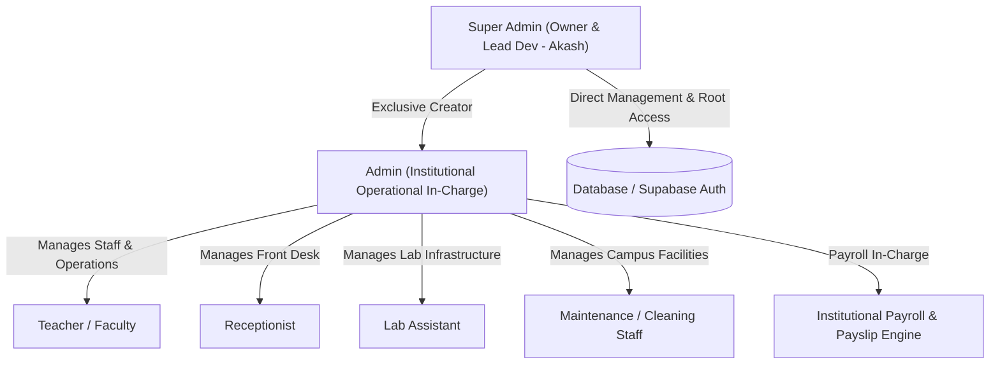

# Task Blueprint: Institutional Payroll, Multi-Role Staff Portal & Super Admin Architecture

> **Execution Directive**: This document captures the user specification for one-shot execution upon user trigger. When instructed ("execute", "proceed", or any trigger prompt referencing this task), the AI agent will implement all 4 phases in sequence without requiring re-prompting.

---

## 1. Original User Specification Snapshot
```text
if income then source payer ther should be auto selected self, and a payer extra filed should be in the system if only otherfiled then only recored the payer name and if self then link student by typing student name or id last three digits [please show the result of linking also at the bottom of the field], if expence and staf salary then a payslip generation option should be there in the not in the modal , in other saction - with a pending status, and payuslip also downloaded from there also and from teachers or employee portal also - remember admin also a employee, also add new employee types, and it'sa login and all other systems - types - receptionist, lab assistant, Maintenance/Cleaning Staff, and admin will be the incharge ,  and super admin - i mean me is the owner and main dev so i should be all the powers, also all management accounts only super admin can create - take this prompt and create a md file for executing and with any prompt execute this prompt for only one time and remind me of this prompt - so create this as a task for next time
```

---

## 2. Institutional Role Hierarchy & Security Invariants



### Role Matrix & Privileges
| Role | Identifier | Portal Gateway | Permissions & Powers |
| :--- | :--- | :--- | :--- |
| **Super Admin** | `super_admin` | `/admin/*`, `/super-admin/*` | **Root & Absolute Owner**. Unrestricted access to full codebase, system settings, financials, database logs, and **exclusive privilege to create & manage administrative/management accounts**. |
| **Admin** | `admin` | `/admin/*` | **Operational In-Charge**. Manages students, courses, routine schedule, fee collection, expenses, and payroll approval. **Admin is also an Employee** on institute payroll. Cannot create other admins. |
| **Teacher / Faculty** | `teacher` | `/teacher/*` | Classes, attendance, student evaluation, personal schedule, and **Personal Payslip Vault**. |
| **Receptionist** | `receptionist` | `/staff/reception/*` | Student enquiry intake, visitor registry, appointment schedules, contact desk, and **Personal Payslip Vault**. |
| **Lab Assistant** | `lab_assistant` | `/staff/lab/*` | PC workstation tracking, lab batch slotting, hardware incident reporting, and **Personal Payslip Vault**. |
| **Maintenance Staff** | `maintenance` | `/staff/maintenance/*` | Campus cleaning checklist, consumable supplies request, facility ticket logs, and **Personal Payslip Vault**. |

---

## 3. Core Modules & Implementation Scope

### Module A: Income Source & Student Linking (Completed Phase 1)
- **Status**: Implemented in [`AddTransactionModal.tsx`](file:///e:/Project/icstconnect/src/admin/components/AddTransactionModal.tsx) and [`StudentSearch.tsx`](file:///e:/Project/icstconnect/src/components/admin/StudentSearch.tsx).
- **Functionality**:
  1. Default auto-selected `👤 Student (Self)` vs `🏢 Other Payer / Entity`.
  2. If `Self`: Search student by full name OR last 3/4 digits of Student ID. Real-time matching dropdown displays student name, email, and ID badge `(#3A1)`.
  3. Linked student card rendered below the field with avatar, full name, ID badge, email, and instant clear button.
  4. If `Other`: Replaces student search with `Payer Name / Source Organization` text input.

### Module B: Dedicated Payroll & Payslip Generation Engine (Outside Transaction Modal)
- **Dedicated Tab in Financials**: `/admin/finance` -> **Payroll & Payslips** tab.
- **Workflow**:
  1. **Employee Roster**: Displays all employees across all roles (`admin`, `teacher`, `receptionist`, `lab_assistant`, `maintenance`).
  2. **Payslip Generation Flow**:
     - Admin or Super Admin selects employee, month, and year.
     - System auto-fills base pay, allowances, incentives, and deductions (PF/TDS/Advances).
     - Initial state: **`Pending`** status.
     - When payment is disbursed: Status moves to **`Paid`** and triggers a synchronized institutional expense under `Faculty & Staff Salaries`.
  3. **Voucher Reference & Serial**: e.g., `PAY-2026-OCT-014`.
  4. **Payslip Download**:
     - Instant printable/downloadable institutional Payslip voucher with ICST seal, employee designation, salary breakdown, and authorized signature block.
     - Available directly in the Admin Payroll view **and** inside the employee's personal portal.

### Module C: Multi-Role Staff Portal & Authentication
- **Unified Staff Login**: `/staff/login` supporting Teachers, Receptionists, Lab Assistants, Maintenance Staff, and Admins.
- **Role-Based Dynamic Routing**:
  - Automatically redirects staff to their role-specific dashboard based on their verified Supabase `role`.
  - Every staff member has a **"My Salary & Payslips"** tab to view payment history and download all their monthly payslips.

### Module D: Super Admin Account Creation Gate
- **Account Management Interface**: `/admin/management-accounts` or `/super-admin/accounts`.
- **Enforcement Invariant**:
  - Strictly visible and accessible **only** if `current_user.role === 'super_admin'`.
  - Only Super Admin can provision new accounts with role `admin`, `teacher`, `receptionist`, etc.
  - Admin users attempting to access account creation receive an unauthorized modal guard.

---

## 4. Database Migration Plan (`database/payroll_and_staff_roles.sql`)

```sql
-- 1. Upgrade roles check constraint on profiles
ALTER TABLE profiles DROP CONSTRAINT IF EXISTS profiles_role_check;
ALTER TABLE profiles ADD CONSTRAINT profiles_role_check 
  CHECK (role IN ('student', 'teacher', 'admin', 'super_admin', 'receptionist', 'lab_assistant', 'maintenance'));

-- 2. Staff Payroll & Payslips Table
CREATE TABLE IF NOT EXISTS staff_payslips (
    id UUID PRIMARY KEY DEFAULT gen_random_uuid(),
    employee_id UUID NOT NULL REFERENCES profiles(id) ON DELETE CASCADE,
    employee_name TEXT NOT NULL,
    employee_role TEXT NOT NULL,
    pay_period_month INT NOT NULL CHECK (pay_period_month BETWEEN 1 AND 12),
    pay_period_year INT NOT NULL CHECK (pay_period_year >= 2020),
    basic_salary NUMERIC(12, 2) NOT NULL DEFAULT 0.00,
    allowances NUMERIC(12, 2) NOT NULL DEFAULT 0.00,
    deductions NUMERIC(12, 2) NOT NULL DEFAULT 0.00,
    net_salary NUMERIC(12, 2) NOT NULL,
    payment_mode TEXT NOT NULL DEFAULT 'bank_transfer',
    payment_date DATE,
    status TEXT NOT NULL DEFAULT 'pending' CHECK (status IN ('pending', 'approved', 'paid', 'cancelled')),
    voucher_no TEXT UNIQUE,
    transaction_id UUID REFERENCES institution_transactions(id) ON DELETE SET NULL,
    remarks TEXT,
    created_at TIMESTAMPTZ DEFAULT NOW(),
    updated_at TIMESTAMPTZ DEFAULT NOW()
);

-- 3. Row Level Security (RLS)
ALTER TABLE staff_payslips ENABLE ROW LEVEL SECURITY;

-- Super Admin has full control
CREATE POLICY "Super admin full access on payslips"
  ON staff_payslips FOR ALL
  TO authenticated
  USING (EXISTS (SELECT 1 FROM profiles WHERE id = auth.uid() AND role = 'super_admin'));

-- Admin has operational access
CREATE POLICY "Admin operational access on payslips"
  ON staff_payslips FOR ALL
  TO authenticated
  USING (EXISTS (SELECT 1 FROM profiles WHERE id = auth.uid() AND role = 'admin'));

-- Employees can view their own payslips
CREATE POLICY "Employees can view own payslips"
  ON staff_payslips FOR SELECT
  TO authenticated
  USING (employee_id = auth.uid());
```

---

## 5. One-Shot Execution Checklist (For Next Prompt)

When the user triggers this task, execute the following steps sequentially:
- [ ] **Step 1**: Run SQL migration `database/payroll_and_staff_roles.sql` via authenticated Supabase client/service.
- [ ] **Step 2**: Create `src/services/payrollService.ts` for payslip generation, status transition (`pending` -> `paid`), PDF/HTML payslip formatting, and employee payslip queries.
- [ ] **Step 3**: Create `src/admin/components/PayrollManager.tsx` and integrate it as the 6th tab in `FinancialDashboard.tsx`.
- [ ] **Step 4**: Build Printable Payslip Voucher modal / download component (`PayslipPrintModal.tsx`).
- [ ] **Step 5**: Create the Employee Portal views:
  - Receptionist Dashboard (`src/staff/receptionist/ReceptionDashboard.tsx`)
  - Lab Assistant Dashboard (`src/staff/lab/LabDashboard.tsx`)
  - Maintenance Staff Dashboard (`src/staff/maintenance/MaintenanceDashboard.tsx`)
  - "My Payslips" component integrated into Teacher and Staff layouts.
- [ ] **Step 6**: Implement Super Admin Account Management screen (`src/admin/pages/SuperAdminAccountManager.tsx`) guarded strictly by `super_admin` role.
- [ ] **Step 7**: Run `npm run build` verification gate to confirm 0 errors and zero regressions.
